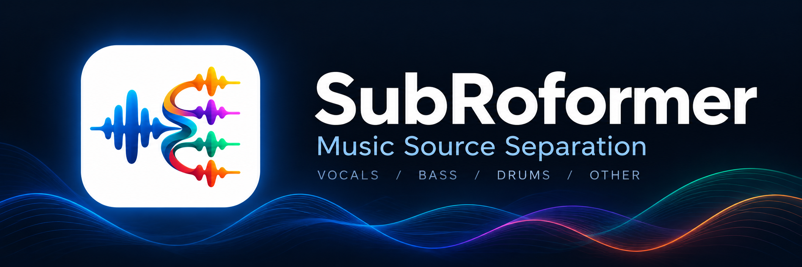

# SubRoformer

This is the official repository for **SubRoformer: Subband Time-Domain
Representation for Music Source Separation**.

Music source separation into **vocals, bass, drums, and other**, with a local
desktop app and tools for SubRoformer's training, evaluation, and inference.

## Contributions

- **Subband time-domain representation:** exposes spectral structure while
  preserving fine temporal and phase information.
- **Efficient subband analysis–synthesis front end:** reduces redundant full-rate
  computation and shortens the sequences presented to the separator.
- **Multiscale axial RoFormer:** captures long-range temporal and cross-band
  dependencies while retaining fine-grained information for mask estimation.

## The app

**SubStemStudio** lets you drop in a song, separate four stems, listen
while separation progresses, and export 48 kHz float32 WAVs. It includes
synchronized spectrograms and per-stem playback controls.

The source app supports macOS, Windows, and Linux. Core ML is the default on
macOS 15+; PyTorch supports CUDA, Apple Silicon (MPS), and CPU.
See the [app installation and usage guide](app/README.md) to get started.

## Checkpoints and test SDR

Both checkpoints are available on
[Hugging Face](https://huggingface.co/archimickey/SubRoformer).

| Checkpoint | Vocals | Bass | Drums | Other | Mean |
| --- | ---: | ---: | ---: | ---: | ---: |
| Original Base, 1.4M updates (EMA) | 12.6863 | 11.4961 | 12.2267 | 9.9445 | **11.5884** |
| Perceptual finetuning, +200k updates (EMA, default) | 12.6424 | 11.1357 | 12.0518 | 9.7584 | **11.3971** |

MUSDB18-HQ full-test `museval` SDR in dB (50 songs). Each stem is the median of
per-song median SDRs; Mean averages the four stem medians. For these extra-data
checkpoint results, see the
[evaluation protocol](docs/evaluation.md#published-test-results).
They are not separate benchmarks of the FP16 or Core ML exports.

The perceptual-finetuned checkpoint sacrifices some SDR (**0.1913 dB** mean)
to prioritize perceptual quality. SDR alone does not establish a perceptual
improvement; that requires matched listening validation. It adds 200k updates
to the 1.4M Base and uses the matching **SiLU** config, not the original
**GEGLU** config. See [checkpoint files and configs](docs/checkpoints.md).

## Documentation

| Task | Guide |
| --- | --- |
| App installation, usage, and native builds | [app/README.md](app/README.md) |
| Python/source installation | [docs/installation.md](docs/installation.md) |
| Training and dataset preparation | [docs/training.md](docs/training.md) |
| Evaluation and SDR protocol | [docs/evaluation.md](docs/evaluation.md) |
| CLI and Python inference | [docs/inference.md](docs/inference.md) |
| Checkpoint downloads and provenance | [docs/checkpoints.md](docs/checkpoints.md) |
| Core ML setup and export | [docs/coreml.md](docs/coreml.md) |
| Tests and validation | [docs/testing.md](docs/testing.md) |

## Acknowledgments

Thanks to Roman Solovyev (ZFTurbo) for
[Music-Source-Separation-Training](https://github.com/ZFTurbo/Music-Source-Separation-Training),
from which this project's dataset and DataLoader code are derived.
