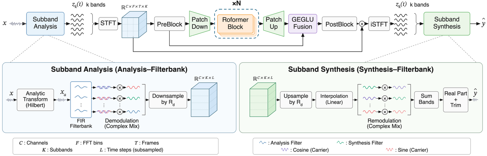

# SubRoformer

This is the official repository for **SubRoformer: Subband Time-Domain Representation for Music Source Separation**. SubRoformer separates music mixtures into four stems: **vocals, bass, drums, and other instruments**.



## Results

| Checkpoint | Vocals | Bass | Drums | Other | Mean |
| --- | ---: | ---: | ---: | ---: | ---: |
| Base (1.4M updates, EMA) | 12.6863 | 11.4961 | 12.2267 | 9.9445 | **11.5884** |
| Perceptually fine-tuned (+200k updates, EMA, default) | 12.6424 | 11.1357 | 12.0518 | 9.7584 | **11.3971** |

The models are trained on **100 MUSDB18-HQ songs** and **500 additional internal songs**. Results are evaluated on the **MUSDB18-HQ test set (50 songs)** using `museval` SDR (dB). Each stem's SDR is the median of per-song median SDRs, and Mean is the average across four stems. See the [evaluation protocol](subroformer/training/README.md#published-test-results).

The **perceptually fine-tuned checkpoint** prioritizes perceptual quality with a **0.1913 dB** reduction in Mean SDR. It adds 200k updates to the Base model and uses **SiLU** instead of **GEGLU**. Both checkpoints are available on [Hugging Face](https://huggingface.co/archimickey/SubRoformer). See [checkpoint details](docs/checkpoints.md).

## 1. Installation

Run from the repository root using Python 3.11:

```bash
uv venv --python 3.11
uv pip install --python .venv/bin/python -e .
```

See the [installation guide](docs/installation.md) for details.

## 2. Inference

### 2.1 Command-Line Interface (CLI)

Use the released perceptually fine-tuned checkpoint (downloaded automatically if needed):

```bash
uv run python -m subroformer.inference \
  --input demo/song.wav \
  --output_dir outputs/song
```

The CLI automatically selects **CUDA → MPS → CPU**, or specify `--device` manually. It outputs four 48 kHz WAV files: `vocals.wav`, `bass.wav`, `drums.wav`, and `other.wav`.

### 2.2 Python Inference

```python
from subroformer.inference.engine import (
    load_audio, load_separator, resolve_amp_dtype, separate_audio,
)

model, config = load_separator(device="auto")
audio = load_audio("demo/song.wav", int(config.audio.sample_rate))
stems = separate_audio(
    model, audio, config,
    amp_dtype=resolve_amp_dtype(next(model.parameters()).device),
)
vocals = stems["vocals"]  # float32 NumPy array: [channels, samples]
```

### 2.3 SubStemStudio App

Demo on [Netrum & Halvorsen - Phoenix](https://www.youtube.com/watch?v=yH88qRmgkGI):

<div align="center">

https://github.com/user-attachments/assets/45b3fa51-0370-4635-a93b-738856479956

</div>

**SubStemStudio** provides a graphical interface for four-stem separation, real-time progress monitoring, synchronized spectrograms, playback controls, and 48 kHz WAV export.

The app supports **macOS, Windows, and Linux**, using Core ML on macOS 15+ by default or PyTorch on CUDA, MPS, and CPU. See the [app guide](app/README.md).

## 3. Training

Train SubRoformer from scratch using MUSDB18-HQ.

### 3.1 Download the Dataset

```bash
bash scripts/download_musdb18hq.sh
```

The extracted dataset has the following structure:

```text
data/
└── musdb18hq/ (~30 GB)
    ├── train/ (100 songs)
    │   ├── A Classic Education - NightOwl/
    │   │   ├── bass.wav
    │   │   ├── drums.wav
    │   │   ├── mixture.wav
    │   │   ├── other.wav
    │   │   └── vocals.wav
    │   └── ...
    └── test/ (50 songs)
        ├── Al James - Schoolboy Facination/
        │   ├── bass.wav
        │   ├── drums.wav
        │   ├── mixture.wav
        │   ├── other.wav
        │   └── vocals.wav
        └── ...
```

### 3.2 Train

Single-GPU training:

```bash
CUDA_VISIBLE_DEVICES=0 uv run accelerate launch \
  --num_processes 1 \
  --mixed_precision bf16 \
  --module subroformer.training.train \
  --config subroformer/configs/sbroformer_base_4stem.yaml \
  --data_path data/musdb18hq/train
```

See the [training guide](subroformer/training/README.md) for multi-GPU training and checkpoint resumption.

### 3.3 Inference with Your Checkpoint

```bash
uv run python -m subroformer.inference \
  --config subroformer/configs/sbroformer_base_4stem.yaml \
  --checkpoint checkpoints/my_run/model_ema.pt \
  --input demo/song.wav \
  --output_dir outputs/my_run
```

## Documentation

| Topic | Guide |
| --- | --- |
| App installation and usage | [App Guide](app/README.md) |
| Installation | [Installation Guide](docs/installation.md) |
| Model architecture and modules | [Package Overview](subroformer/README.md) |
| Model configurations | [Configuration Guide](subroformer/configs/README.md) |
| Training and evaluation | [Training Guide](subroformer/training/README.md) |
| CLI and Python inference | [Inference Guide](subroformer/inference/README.md) |
| DSP backends | [Frontend Guide](subroformer/frontend/README.md) |
| Checkpoints | [Checkpoint Guide](docs/checkpoints.md) |
| Core ML | [Core ML Guide](subroformer/inference/README.md#core-ml-inference) |
| Testing | [Testing Guide](docs/testing.md) |
| Inference optimization | [Optimization Guide](docs/inference_optimization.md) |

## Acknowledgments

We thank **Roman Solovyev (ZFTurbo)** for [Music-Source-Separation-Training](https://github.com/ZFTurbo/Music-Source-Separation-Training), from which the dataset handling and DataLoader code are derived.